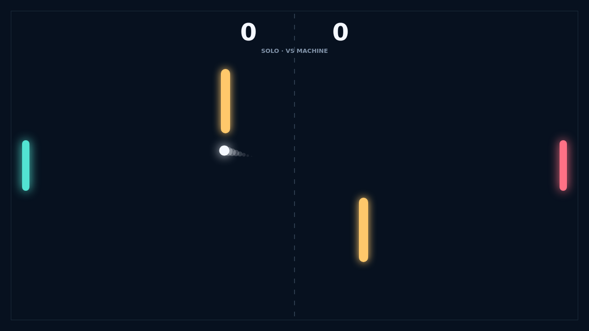

A Carom match opens with the ball waiting at center and both paddles set. When the serve breaks, the rally stretches from one edge of the field to the other, with each player trying to read the next angle.

Move as the ball reaches your paddle and the stroke carries spin into its flight. A quick downward sweep can bend a return toward the floor; an upward sweep sends it arcing the other way.

The gold bars make the open field a bank-shot puzzle. A sharp rebound can turn a safe return into a surprise, and every obstacle bounce keeps the spin alive.

Race to eleven and hold a two-point lead to take the match. Play Solo against the machine or share the keyboard for a local Versus duel.

